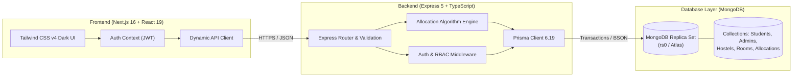

# 🏠 HostelIQ — Smart Hostel Room Allocation Platform
### *DBMS Capstone Project*


A modern, full-stack campus accommodation and automated room allocation management system. HostelIQ empowers students with a seamless room reservation portal while providing hostel wardens and campus administrators with automated room assignment algorithms, real-time occupancy statistics, and comprehensive student housing analytics.

---

## 🌐 Live Cloud Deployment

| Service | Live URL | Description |
| :--- | :--- | :--- |
| **Frontend Portal** | [https://hostel-allocation-frontend.onrender.com](https://hostel-allocation-frontend.onrender.com) | Responsive Next.js Web Application |
| **Backend API** | [https://hostel-allocation-api.onrender.com](https://hostel-allocation-api.onrender.com) | Express & TypeScript REST API |
| **API Health Check** | [https://hostel-allocation-api.onrender.com/api/health](https://hostel-allocation-api.onrender.com/api/health) | Real-time container & database status |

> **Note on Free Hosting**: Render free instances spin down during periods of inactivity. If the service is asleep, the first request may take 30–50 seconds to initialize.

---

## 🔑 Demo Credentials

| Role | Email Address | Password | Permissions & Features |
| :--- | :--- | :--- | :--- |
| **Admin** | `admin@hostel.edu` | `Admin@123` | Full dashboard access, hostel/room CRUD, 1-click auto-allocate, request approvals, student directory |
| **Student** | `sanchit@student.edu` | `Student@123` | Room browsing, hostel filtering, priority application submission, roommate details |
| **Student (Alt)** | `aarav.sharma001@gmail.com` | `Student@123` | Pre-allocated student account with active room assignment |

---

## ✨ Key Features

### 🎓 Student Experience
- **Interactive Room Catalog**: Browse Boys and Girls hostels with dynamic filters (AC / Non-AC, floor levels, monthly pricing, and amenities).
- **Preference-Based Requests**: Submit accommodation requests selecting up to 3 prioritized room preferences.
- **My Room Dashboard**: View active room assignment details, hostel contact information, fee details, and roommate information.
- **Application Tracking**: Monitor real-time status of submitted requests (`PENDING`, `APPROVED`, `ALLOCATED`, `REJECTED`).

### 🛡️ Admin Command Center
- **Real-Time KPI Metrics**: Live statistics on total students, active allocations, available vs. occupied capacity, and occupancy rate percentage.
- **Automated Allocation Engine**: High-throughput rule engine that automatically matches unassigned students to vacant rooms based on gender compatibility and priority rankings.
- **Hostel & Room Management**: Create and configure hostels, add floors/rooms, customize bed capacity, and adjust rental rates.
- **Student Database**: Search and filter enrolled student profiles, academic courses, and contact information.

### 🔒 Enterprise-Grade Security
- **JWT Authentication**: Short-lived access tokens with automatic rotation via HTTP refresh tokens.
- **Role-Based Access Control (RBAC)**: Enforced middleware boundaries guarding administrative endpoints.
- **Bcrypt Encryption**: 12-round salted hashing for all stored credentials.
- **Security Hardening**: Helmet HTTP headers, input schema validation via Zod, and configured Cross-Origin Resource Sharing (CORS).

---

## 🏛️ System Architecture



---

## 🔄 DBMS Academic Contrast: SQL vs. NoSQL

This capstone project implements the operational application using **MongoDB with Prisma 6** (requiring replica set support for multi-document ACID transactions). The relational MySQL/MariaDB schema is preserved in [`sql-reference/`](file:///c:/Users/ASUS/OneDrive/DBMS-CapstoneProject/sql-reference/README.md) for curriculum syllabus comparison:

| Database Concept | Relational SQL Model (`sql-reference/`) | NoSQL Document Model (`prisma/schema.prisma`) |
| :--- | :--- | :--- |
| **Data Entity** | `TABLE students (...)` | Collection documents (`model Student`) |
| **Primary Key** | `CHAR(36)` UUID string | `ObjectId` mapped from `_id` |
| **Entity Relationship** | `FOREIGN KEY ... REFERENCES` | Scalar `ObjectId` + Prisma virtual relations |
| **Multi-Table Queries** | `INNER JOIN` / `LEFT JOIN` / `GROUP BY` | Prisma `include` nested lookups & aggregation |
| **Schema Evolution** | `ALTER TABLE` / Migration files | Dynamic schema updates with `prisma db push` |
| **Data Integrity** | `UNIQUE`, `CHECK`, Foreign key constraints | Prisma model attributes (`@unique`, `@@unique`, enum types) |

---

## 🚀 Quick Start & Local Development

HostelIQ includes automated helper scripts that configure and run a local MongoDB replica set (`rs0`) on port `27018` with zero manual database administration.

### Prerequisites
- [Node.js](https://nodejs.org/) (v18 or later)
- [MongoDB Community Server](https://www.mongodb.com/try/download/community) installed locally (or a free MongoDB Atlas connection string)

### 1. Clone & Install Dependencies
```bash
# Clone the repository
git clone https://github.com/sanchitupneja/DBMS-Capstone-Project.git
cd DBMS-Capstone-Project

# Install backend dependencies
npm install

# Install frontend dependencies
npm install --prefix frontend
```

### 2. Zero-Config Database Setup
Run the automated database setup script. This script automatically starts the local MongoDB replica set on port `27018`, initializes `rs0`, syncs the schema via Prisma, and seeds 160+ students, hostels, rooms, and demo accounts:
```bash
npm run db:setup
```

### 3. Start Development Servers
Start MongoDB, the Express backend, and the Next.js frontend in a single unified command:
```bash
npm run dev:all
```

- **Frontend**: [http://localhost:3000](http://localhost:3000)
- **Backend API**: [http://localhost:5000](http://localhost:5000)
- **Prisma Studio (Optional GUI)**: `npm run db:studio` (available at [http://localhost:5555](http://localhost:5555))

---

## ☁️ Deployment Guide (Render & MongoDB Atlas)

The repository includes a ready-to-use [`render.yaml`](file:///c:/Users/ASUS/OneDrive/DBMS-CapstoneProject/render.yaml) Blueprint that provisions both web services simultaneously.

### Step 1: Provision Free Cloud Database (MongoDB Atlas)
1. Register for a free account at [MongoDB Atlas](https://www.mongodb.com/atlas) and create an **M0 Free Shared Cluster**.
2. Under **Security → Network Access**, add IP address `0.0.0.0/0` (allow access from anywhere).
3. Under **Security → Database Access**, create a user with read/write permissions.
4. Click **Connect → Drivers → Node.js** and copy your connection string:
   ```text
   mongodb+srv://<USER>:<PASSWORD>@cluster.mongodb.net/hostel_allocation_db?retryWrites=true&w=majority
   ```

### Step 2: Deploy with Render Blueprint
1. Sign in to [Render](https://dashboard.render.com).
2. Click **New +** → **Blueprint**.
3. Select your GitHub repository (`sanchitupneja/DBMS-Capstone-Project`) and branch `main`.
4. When prompted for `DATABASE_URL`, paste your MongoDB Atlas connection string.
5. Click **Apply**. Render will automatically build the Docker API container and compile the Next.js frontend.

---

## 📡 RESTful API Reference

### Authentication (`/api/auth`)
| Method | Endpoint | Description | Auth Required |
| :--- | :--- | :--- | :--- |
| `POST` | `/api/auth/register/student` | Register a new student account | Public |
| `POST` | `/api/auth/login` | Authenticate user (Admin or Student) | Public |
| `POST` | `/api/auth/refresh-token` | Renew expired access token | Public |
| `GET` | `/api/auth/me` | Fetch authenticated profile details | Bearer Token |
| `POST` | `/api/auth/logout` | Invalidate active session | Bearer Token |

### Hostels & Rooms (`/api/hostels`)
| Method | Endpoint | Description | Auth Required |
| :--- | :--- | :--- | :--- |
| `GET` | `/api/hostels` | List hostels with room count & filtering | Public |
| `GET` | `/api/hostels/:id` | Get hostel details with room availability | Public |
| `POST` | `/api/hostels` | Create new hostel | Admin Only |
| `PUT` | `/api/hostels/:id` | Update hostel information | Admin Only |
| `DELETE` | `/api/hostels/:id` | Soft-deactivate hostel | Admin Only |
| `GET` | `/api/hostels/:id/rooms` | List rooms inside specific hostel | Public |

### Allocations & Requests (`/api`)
| Method | Endpoint | Description | Auth Required |
| :--- | :--- | :--- | :--- |
| `GET` | `/api/requests` | List allocation requests | Student / Admin |
| `POST` | `/api/requests` | Submit new room allocation request | Student Only |
| `PATCH` | `/api/requests/:id` | Approve, reject, or cancel request | Admin Only |
| `POST` | `/api/allocations/auto` | Trigger automatic allocation engine | Admin Only |
| `GET` | `/api/allocations/my` | View student's current room assignment | Student Only |
| `GET` | `/api/allocations/admin/dashboard` | Aggregated analytics & KPI statistics | Admin Only |

### Health Check (`/api/health`)
| Method | Endpoint | Description | Auth Required |
| :--- | :--- | :--- | :--- |
| `GET` | `/api/health` | Service uptime and database connectivity probe | Public |

---

## 📂 Project Directory Structure

```text
DBMS-CapstoneProject/
├── Dockerfile                  # Production container definition for backend API
├── docker-entrypoint.sh        # Startup script for schema sync & validation
├── render.yaml                 # Infrastructure-as-code Blueprint for Render
├── package.json                # Backend scripts and dependencies
├── tsconfig.json               # Backend TypeScript configuration
├── .env.example                # Template for environment configuration
│
├── prisma/
│   ├── schema.prisma           # Prisma 6 MongoDB object data models
│   ├── seed.ts                 # Database seeder (hostels, rooms, 160+ students)
│   └── seed-allocations.ts     # Allocation record generation script
│
├── scripts/
│   ├── start-mongo.js          # Local replica set daemon controller
│   ├── setup-local-db.js       # 1-step automated setup and seeding script
│   └── init-replset.js         # Mongo shell script to initialize rs0
│
├── src/
│   ├── server.ts               # Express application entrypoint
│   ├── app.ts                  # Middleware pipeline, CORS & route mounting
│   ├── config/database.ts      # Singleton Prisma Client instance
│   ├── controllers/            # Request handlers (auth, hostels, allocations)
│   ├── middleware/             # Authentication & Zod schema validation
│   ├── routes/                 # Express route definitions
│   ├── services/               # Business logic & auto-allocation algorithms
│   └── utils/                  # JWT utilities & standardized error classes
│
├── frontend/                   # Next.js 16 Web Application
│   ├── package.json            # Frontend dependencies (React 19, Tailwind v4)
│   ├── next.config.ts          # Next.js build and environment configuration
│   ├── postcss.config.mjs      # Tailwind CSS v4 PostCSS pipeline
│   ├── contexts/AuthContext.tsx# Client-side authentication provider
│   ├── lib/api.ts              # Dynamic API client with Render auto-detection
│   └── app/
│       ├── layout.tsx          # Root HTML layout and providers
│       ├── page.tsx            # Landing redirect
│       ├── login/              # Unified Admin/Student sign-in page
│       ├── register/           # Student registration page
│       ├── dashboard/          # Role-based dashboard (Student / Admin KPI)
│       ├── hostels/            # Interactive room explorer
│       ├── my-room/            # Student allocation & roommate view
│       ├── my-request/         # Application history & submission
│       └── admin/              # Management views (hostels, rooms, requests)
│
└── sql-reference/              # Academic relational MySQL reference material
    ├── README.md               # Syllabus documentation & conceptual mapping
    ├── schema.sql              # Relational DDL definitions
    └── hostel_allocation_db.sql# Sample relational data and JOIN queries
```

---

## 📜 Academic Attribution & License

Developed as a comprehensive Capstone Project for the **Database Management Systems (DBMS)** curriculum.  
Released under the [ISC License](LICENSE).
